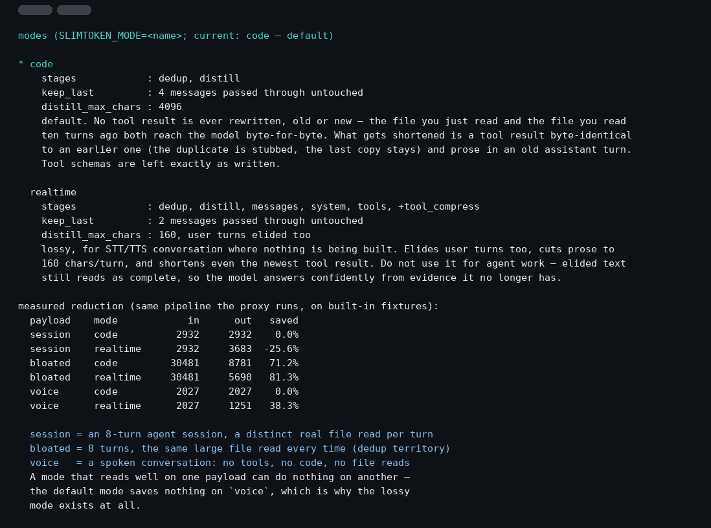

<div align="center">


# SlimToken

**A token-optimization and memory layer between your agent and its model.**

It rewrites each request before it leaves your machine: duplicate tool output is collapsed to a short pointer, old turns are distilled, and oversized requests are pruned to a token budget. Run it as a proxy, an MCP server, a CLI, or a plain Python library.

[](pyproject.toml)
[](LICENSE)
[](pyproject.toml)
[](#overview)

[Overview](#overview) · [Screenshots](#screenshots) · [Quick start](#quick-start) · [Usage](#usage) · [Configuration](#configuration) · [License](#license)

</div>

---

## Overview

SlimToken sits between your agent and its model backend. It runs as a proxy, an
MCP server, a CLI or a Python library, and speaks Anthropic, OpenAI and Ollama
HTTP.

**Why use it:**

- **Cloud models:** fewer tokens sent per request means lower API cost and
  lower rate-limit consumption. Nothing else about the interaction changes.
- **Local models:** fewer tokens to process means faster first token and faster
  total response. On a CPU backend, prompt processing is often the majority of
  the wait, so trimming prompt tokens is the cheapest speedup available.
- **Both:** it keeps the conversation below a token budget, so long agent
  sessions do not hit the model's context limit.

Measured on a local CPU backend with strict prompt caching:

| Workload | Before | After | Effect |
|---|---:|---:|---|
| Same large tool output read four times | 25,713 | 7,029 | 2.4× faster end-to-end |
| 13-request growing agent session | 14,161/request | 11,288/request | ~14% faster session |
| No repeated content | unchanged | unchanged | no benefit, no harm (~5 ms overhead) |

## Screenshots



## Quick start

```bash
git clone https://github.com/greyok00/slimtoken
cd slimtoken
./scripts/install.sh   # pip install -e . + slimtoken install
slimtoken serve        # proxy on port 8181; point your client at it
```

`slimtoken install` rewrites `ANTHROPIC_BASE_URL` to point at the proxy. Any
client that sends Anthropic, OpenAI or Ollama requests through it is optimized
without further setup.

## Usage

### 1. In front of a local model server

If a local backend (llama.cpp's `llama-server`, Ollama, or anything
OpenAI-compatible) answers on port 8080, this is zero-configuration — every
request is trimmed before it reaches the CPU:

```bash
llama-server --port 8080 &          # your model, unchanged
slimtoken serve --upstream http://127.0.0.1:8080
# clients now point at http://127.0.0.1:8181 instead of :8080
```

On CPU, prompt processing dominates long-context requests, so cutting prompt
tokens directly shortens time-to-first-token.

### 2. In front of a cloud API or coding agent

The proxy speaks HTTPS to the upstream with system CAs, so pointing it at
`api.anthropic.com` works without certificate setup:

```bash
slimtoken serve --upstream https://api.anthropic.com
ANTHROPIC_BASE_URL=http://127.0.0.1:8181 claude
```

Billing metering reads the same wire format the API does, so the token counts
you stop sending are the token counts you stop paying for.

### 3. As a service, with measured savings

The proxy writes a cumulative stats ledger when `SLIMTOKEN_STATS_FILE` is set:

```ini
# /etc/systemd/system/slimtoken.service
[Service]
Environment=SLIMTOKEN_UPSTREAM=https://api.anthropic.com
Environment=SLIMTOKEN_STATS_FILE=/var/lib/slimtoken/stats.json
ExecStart=/usr/local/bin/slimtoken serve
```

```bash
slimtoken savings              # requests minified, tokens in/out/saved, mean %, trend
slimtoken savings --json       # same, for dashboards
slimtoken latency --port 8181  # per-request timings against a running proxy
```

### 4. One-off, without a server

The CLI runs the same pipeline over a saved request file, and everything dropped
by the dedup stage can be recalled verbatim:

```bash
cat request.json | slimtoken optimize        # print token counts in/out
slimtoken recall <digest>                    # return the exact dropped bytes
slimtoken modes --measure                    # what each mode saves on your text
slimtoken savings                            # the running proxy's ledger
```

### 5. Inside an MCP-aware agent runtime

`slimtoken-mcp` exposes the same pipeline as MCP tools (`optimize_messages`,
`estimate_tokens`, `prune_context`, `minify_tool_result`, `inspect_budget`,
`get_config`, `list_model_presets`). Also shipped: `slimtoken-reframe-mcp`
(turns a rambling prompt into a tight instruction with no model call) and
`slimtoken-memory-mcp` (the memory store).

## Web lanes

Every SlimToken proxy answers Ollama-style web routes on its own port, so tools
that expect them work even when the local Ollama daemon lacks the routes:

```bash
curl -X POST http://127.0.0.1:8181/api/web_search \
     -d '{"query": "free ai testing tools", "max_results": 5}'
curl -X POST http://127.0.0.1:8181/api/web_fetch \
     -d '{"url": "https://example.com/article"}'
```

- `web_search`: SearXNG first (`SLIMTOKEN_SEARXNG`, default
  `http://127.0.0.1:8888`), with a keyless DuckDuckGo-lite fallback. Returns
  `{query, lane, results: [{title, url, description}]}`.
- `web_fetch`: polite user agent, redirects followed, HTML stripped to readable
  text with a 200 KB cap. Returns `{url, status, text, content_type}`.
- Both routes also answer at the unprefixed `/web_search` and `/web_fetch`.
- They bypass the minify pipeline, run network I/O off the event loop, and
  degrade with a JSON error rather than a hang when every lane fails.

## What runs by default

The default `code` mode never rewrites a tool result, never touches model
output, and keeps the newest four messages verbatim. What it removes is a
byte-identical duplicate of something already in the conversation, and it
stores every dropped byte for exact recall.

| Stage | Default | Toggle | What it does |
|---|---|---|---|
| Tool-result dedup | on | `SLIMTOKEN_MINIFY_DEDUP=0` | A byte-identical repeat is replaced with a short pointer at its later position; the last copy stays |
| Distill old turns | on | `SLIMTOKEN_MINIFY_DISTILL=0` | Old assistant prose beyond the newest four turns is compressed to extractive summaries; code and JSON are exempt |
| Token budget | on (131,072) | `SLIMTOKEN_MINIFY_BUDGET=<n>` | Prunes whole turns without splitting tool_use/tool_result pairs |
| Tool-schema minify | off | `SLIMTOKEN_MINIFY_TOOLS=1` | Drops redundant JSON-schema fields from tool definitions |
| System-prompt minify | off | `SLIMTOKEN_MINIFY_SYSTEM=1` | Shrinks the system prompt; fenced code stays verbatim |
| Message minify | off | `SLIMTOKEN_MINIFY_MESSAGES=1` | Collapses blank lines outside code fences |
| Output caps | off | `SLIMTOKEN_MAX_TOKENS` / `SLIMTOKEN_STOP` | Caps or truncates streamed completions |
| Whole pipeline | on | `SLIMTOKEN_MINIFY=0` | Disables all rewriting for that process |

Two guarantees sit on top:

1. **Prompt-cache safety.** A repeat is stubbed at its later position, so
   earlier messages never change and exact-prefix caches stay valid. Set
   `SLIMTOKEN_DEDUP_APPEND_ONLY=0` only to restore the pre-0.7.2 behavior.
2. **Reversibility.** Every dropped byte is stored under its SHA-256 digest in
   `~/.slimtoken/artifacts` and can be recalled verbatim.

## Modes

`slimtoken modes` lists them; `slimtoken modes --measure` prints what each one
saves on your own text.

- **`code`** (default) — dedup + distill + token budget. Not lossy: nothing is
  removed that is not stored elsewhere.
- **`realtime`** — lossy, for speech-to-speech conversation only: all five
  stages on, prose cut to 160 characters per turn, user turns elided too. Do
  not use it for agent work; elided text still reads as complete, so the model
  can answer confidently from evidence it no longer has.

`SLIMTOKEN_MODE` selects a mode; any explicit `SLIMTOKEN_MINIFY_<STAGE>`
switch overrides the mode for that one stage.

## Configuration

| Variable | What it controls |
|---|---|
| `SLIMTOKEN_MODE` | `code` (default) or `realtime` |
| `SLIMTOKEN_MINIFY` | `0` disables all rewriting |
| `SLIMTOKEN_MINIFY_<STAGE>` | Per-stage toggle (`DEDUP`, `DISTILL`, `TOOLS`, `SYSTEM`, `MESSAGES`) |
| `SLIMTOKEN_MINIFY_BUDGET` | Token-budget ceiling (default 131072) |
| `SLIMTOKEN_KEEP_LAST` | Newest messages kept verbatim (default 4) |
| `SLIMTOKEN_DEDUP_MIN_CHARS` | Minimum result size before dedup applies (default 200) |
| `SLIMTOKEN_DISTILL_MAX_CHARS` | Prose cutoff per old turn (mode default 4096) |
| `SLIMTOKEN_DISTILL_INCLUDE_USER` | `1` also elides old user turns (off in `code`) |
| `SLIMTOKEN_MINIFY_TOOL_SKIP` | Comma-separated tool names never deduplicated |
| `SLIMTOKEN_DEDUP_APPEND_ONLY` | `1` (default) stubs later duplicates |
| `SLIMTOKEN_UPSTREAM` | Backend URL (default `http://127.0.0.1:8080`) |
| `SLIMTOKEN_PORT` | Proxy listen port (default 8181) |
| `SLIMTOKEN_HTTP2` | Opt-in HTTP/2 forwarding |
| `SLIMTOKEN_STATS_FILE` | Path for cumulative minify stats JSON |
| `SLIMTOKEN_MAX_TOKENS` / `SLIMTOKEN_STOP` | Output caps; off by default |
| `SLIMTOKEN_ARTIFACT_DIR` | Where recalled originals are stored |
| `SLIMTOKEN_STATE_DIR` | Root for artifacts and stats state |
| `SLIMTOKEN_TLS_CA` / `_INSECURE` / `_CLIENT_CERT` / `_CLIENT_KEY` | TLS to the backend |
| `SLIMTOKEN_MEMORY_DIR` | Memory store root (default `~/.slimtoken/memory`) |
| `SLIMTOKEN_LAZY_MCP_CONFIG` | Path of the lazy-MCP server list |

For provider-side prompt caching, keep the cache-safe stage set:
`SLIMTOKEN_MINIFY_MESSAGES=0 SLIMTOKEN_MINIFY_DISTILL=0
SLIMTOKEN_MINIFY_SYSTEM=0`. Tools, append-only dedup and the loop guard stay on.
Lossy passes rewrite earlier turns and invalidate the cached prefix.

```bash
# Local llama.cpp server (default)
export SLIMTOKEN_UPSTREAM="http://127.0.0.1:8080"

# Ollama instead - local :11434 or an Ollama cloud host
export SLIMTOKEN_UPSTREAM="http://127.0.0.1:11600/v1"
```

## Install

Requirements: Python 3.13+ and pip. There are no compiled modules or platform
restrictions. `tiktoken` is the only non-trivial dependency, and its tokenizer
table ships inside the package for offline use.

```bash
git clone https://github.com/greyok00/slimtoken
cd slimtoken && ./scripts/install.sh
# or: pip install .
```

## Verify

```bash
slimtoken modes --measure     # what each mode saves, measured on your tokenizer
slimtoken latency --port 8181 # per-request timings through a running proxy
slimtoken savings             # hard savings facts from the stats ledger
python3 -m pytest tests/      # test suite
```

## How it compares

| Tool | Relationship to SlimToken |
|---|---|
| CLI coding agents | The agent runs the loop and calls the model directly; SlimToken shrinks each call in between |
| Open Interpreter / OpenHands | They host the agent loop in-process; SlimToken is a network sidecar underneath any host |
| aider | Manages git-integrated edits; SlimToken edits nothing — it makes the requests around it cheaper |
| LangChain-style frameworks | Shape requests inside your app; SlimToken applies the same passes externally to every client |

## License

Apache-2.0. See [LICENSE](LICENSE).
