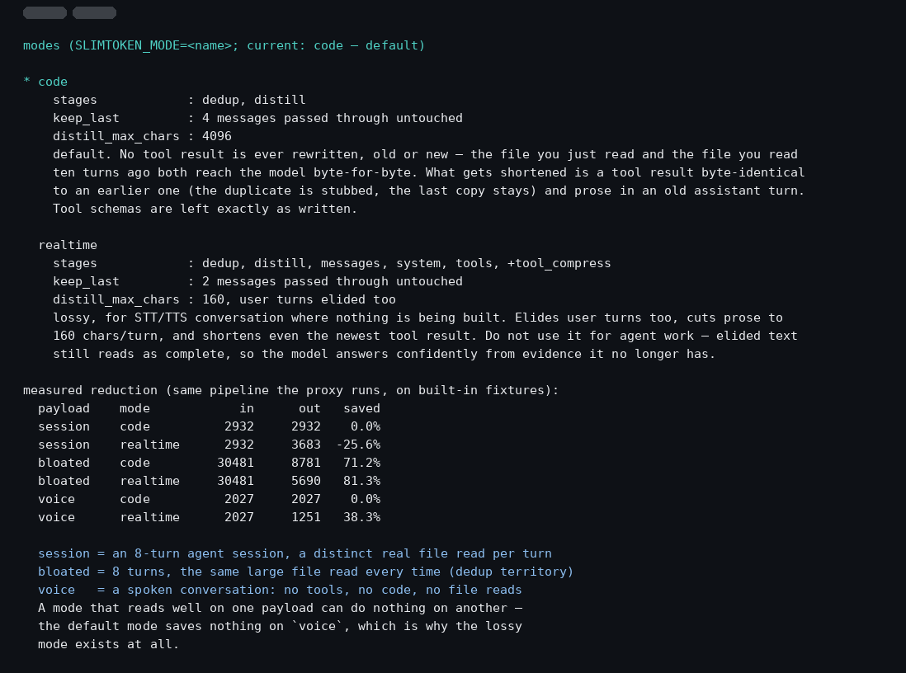

<p align="center">
  
</p>

slimtoken is a standalone token-optimization and memory layer for LLM requests.
Before each request leaves your machine it deduplicates byte-identical tool
results, distills old turns, and prunes to a token budget; tool-schema, system-
prompt, and message minification are opt-in stages, and the lossy `realtime`
mode exists only for conversation use. It runs on your own machine as an
async proxy in front of any Anthropic, OpenAI, or Ollama-compatible backend,
or as an MCP server, a CLI, or a plain Python library. Nothing is hosted; no
network service beyond your chosen model backend is contacted.



## Quick start

```bash
git clone https://github.com/greyok00/slimtoken
cd slimtoken
./scripts/install.sh   # pip install -e . + slimtoken install
slimtoken serve        # proxy on port 8181; point your client at it
```

Details, including installing from a release wheel instead of a clone, are
under [Install](#install).

## What it does

1. A client points at the slimtoken proxy instead of the model backend
   (`slimtoken install` rewrites `ANTHROPIC_BASE_URL`).
2. Each request passes through the pipeline. The default `code` mode runs the
   two stages that are safe for agent work — byte-identical tool-result dedup
   with append-only stubbing, and distill of old turns — plus a token-budget
   backstop. Tool-schema, system-prompt, and message minification are
   additional stages you opt into per environment variable
   (`SLIMTOKEN_MINIFY_TOOLS=1` and friends); they are part of the library and
   of the lossy `realtime` mode, not of the proxy default.
3. Code blocks are never touched. Dedup replaces a tool result only when it is
   byte-identical to another copy, and the dropped copy is stored, so
   `slimtoken recall <digest>` retrieves the exact original.
4. **Prompt-cache safety.** Dedup stubs the *later* duplicate ("identical to an
   earlier tool_result"), keeping every earlier message byte-stable. Rewriting
   *earlier* messages would invalidate exact-prefix prompt caches (Anthropic
   documents that cached segments must match exactly); shipping that was a
   measured regression, fixed in 0.7.2. Set `SLIMTOKEN_DEDUP_APPEND_ONLY=0` to
   restore the old oldest-copy-stubbing behavior.
4. The request is forwarded to your backend and the response comes back
   essentially untouched; overhead is a few milliseconds.
5. Optionally, agent memory is served from `~/.slimtoken/memory`: an
   uncapped hot/warm/cold store with atomic writes and a distiller that folds
   old material into short summaries.

## Benchmarks

Measured 2026-10-31 against a local CPU-only Qwen3.5-4B backend with strict
exact-prefix caching (methodology and raw data: [BENCHMARK_REPORT.md](BENCHMARK_REPORT.md)).
Numbers are workload-specific; token reduction is not speed.

- Proxy overhead: 4–8 ms per request in every mode (mock upstream, n=40).
- A workload dominated by repeated large tool output: 47.4 s → 18.5 s end-to-end
  (2.4× faster) with the default pipeline — token reduction where prompt
  processing dominates.
- Workloads with no duplicate content (fresh versions, unique prose): no speed
  change beyond ~1 s (pipeline has nothing to remove).
- A 13-request warm agent session: the 0.7.1 shipped pipeline was a net wash
  because stubbing the older duplicate copy invalidated the exact-prefix prompt
  cache at the moment the duplicate appeared (measured: cached prefix 3506 → 0).
  0.7.2's append-only stubbing keeps the cache and the token savings — 14%
  faster end-to-end than either the 0.7.1 pipeline or raw passthrough.
- The lossy `realtime` mode is faster still but discards old turns on purpose;
  do not use it for agent work.

## How it works

- **Pipeline** (`slimtoken/pipeline`) — one pass over each request that runs
  the enabled stages in order and returns the rewritten body plus a stats
  record; if nothing would change, it returns the original bytes untouched.
- **Stages** — `dedup_tool_results` stubs a tool result that is byte-identical
  to another copy (append-only by default: later copies are stubbed, earlier
  messages stay byte-stable so exact-prefix prompt caches survive; the dropped
  copy is stored and recallable); `distill_old_turns` replaces distant prose
  with extractive summaries (no model call); `token_budget` prunes to the
  configured ceiling. Opt-in stages: `tool_minify` deduplicates and trims tool
  JSON schemas; `system_minify` shrinks the system prompt (fence-aware, code
  stays verbatim); `message_minify` cleans message bodies the same way;
  `tool_result_compress` / `dom_pruner` compress oversized tool output and DOM
  text — these run in the lossy `realtime` mode or via their env switches.
- **Modes** — `code` (default) = dedup + distill + budget, never rewrites a
  tool result beyond exact duplicates; `realtime` additionally elides old
  turns and shortens the newest tool result, for speech-to-speech conversation
  only. `SLIMTOKEN_MODE` selects; `SLIMTOKEN_MINIFY=0` disables everything.
- **Proxy** (`slimtoken/proxy`) — an asyncio HTTP/1.1 forwarder that points at
  `SLIMTOKEN_UPSTREAM` (default `http://127.0.0.1:8080`) and listens on port
  8181; it keeps full-fidelity streaming and passes responses through without
  rewriting model output.
- **Artifacts** — every dropped byte is stored under a sha256 digest in
  `~/.local/state/slimtoken/artifacts`; `slimtoken recall <digest>` prints the
  exact original, so compression is reversible by construction.
- **Memory** (`slimtoken.memory`) — a JSON/SQLite store at `~/.slimtoken/memory`
  with hot/warm/cold tiers, atomic appends, a scheduler, a loop guard, and
  lifecycle hooks; writes are local files, nothing leaves the machine.
- **MCP servers** — `slimtoken-mcp` (tools server, stdio) and
  `slimtoken-reframe-mcp` (a CPU-only pass that turns a rambling prompt into a
  tight instruction without an LLM round-trip), plus a memory MCP server over
  the same store. Any MCP client that speaks stdio JSON-RPC can use them.

## Tools

Built-in MCP tools exposed by `slimtoken-mcp`:

| Tool | What it does |
|------|--------------|
| `slimtoken.optimize_messages` | runs the full minify pipeline on a request body |
| `slimtoken.estimate_tokens` | counts tokens for a payload with the bundled cl100k tokenizer |
| `slimtoken.prune_context` | cuts a message list to a token budget |
| `slimtoken.minify_tool_result` | shrinks one oversized tool result |
| `slimtoken.inspect_budget` | reports how close a request is to the budget |
| `slimtoken.get_config` | prints the active mode and stage configuration |
| `slimtoken.list_model_presets` | lists llama-server presets by GPU VRAM tier |
| `slimtoken.high_context_presets` | lists dense/MoE presets sized for long context |

Memory MCP server launch: `slimtoken-memory-mcp` (stdio; missing from releases
before 0.7.2 — `python -m slimtoken.memory.mcp_server` cannot run a compiled
module, so there was no working invocation). Memory MCP tools (same store):
`read`, `write`,
`search`, `clear` per tier, plus `stats` (store sizes), `integrity` (per-tier
checksum validation), `cold_list`, `workflow_run`/`workflow_status` (ordered
task scripts under `~/.slimtoken/workflow`), and `cron_parse` (cron
expression → ISO timestamps).

**MCP support:** any MCP-capable agent can connect to `slimtoken-mcp` and the
memory server directly. `slimtoken lazy-mcp` additionally fronts your other
MCP servers: it lists one generic stub tool per configured server (from
`~/.slimtoken/lazy_mcp.json`) so an agent never loads every server's full
schema set at startup, and calls through to the real server on demand. No
third-party MCP servers are installed by default — configure your own in
`~/.slimtoken/lazy_mcp.json`.

**Example session:** point Claude Code or any ANTHROPIC_BASE_URL client at the
proxy, then run an agent that reads files. Each request loses its duplicated
tool results automatically; `slimtoken recall <digest>` brings any dropped text
back verbatim; the memory server keeps the agent's notes on disk across runs.
Token reduction is workload-specific: on a payload where the same large file
output appears repeatedly, dedup removes most of those repeated tokens (run
`slimtoken modes --measure` for your own machine's table), and token reduction
is *not* proportional to speed — see the measured numbers under
[Benchmarks](#benchmarks).

## The tree explained

| Directory | Contents | Shipped as |
|-----------|----------|------------|
| `src/slimtoken/` | pipeline, stages, proxy, CLI, MCP servers, memory | compiled `.so` modules (Cython, CPython 3.13 x86_64) plus thin `.py` package shims |
| `scripts/` | `install.sh`, `uninstall.sh` | plain bash |
| `tests/` | unit + integration smoke suite | plain `.py` |
| `src/slimtoken/data/` | bundled cl100k tokenizer vocab | plain data file |

## Install

Requirements: CPython 3.13 on Linux (x86_64), ~50 MB disk. The published wheel's
compiled modules are Cython-built for that exact interpreter/platform combination —
there is no source fallback, so other Python versions and platforms are not
supported. No compiled backend is required at runtime —
the proxy works against Anthropic/OpenAI/Ollama-compatible HTTP endpoints.

Default backend is whatever you point at (`SLIMTOKEN_UPSTREAM`, default
`http://127.0.0.1:8080` — a local llama-server, or any Anthropic/OpenAI/Ollama
endpoint).

From a clone:

```bash
git clone https://github.com/greyok00/slimtoken
cd slimtoken
./scripts/install.sh   # pip install -e . + slimtoken install
```

From the release, without cloning:

```bash
gh release view -R greyok00/slimtoken --json assets -q '.assets[].name'
gh release download -R greyok00/slimtoken
pip install slimtoken-0.7.2-*.whl
slimtoken install       # or: slimtoken serve --upstream http://127.0.0.1:8080
```

## Configuration

| Variable | What it controls |
|----------|------------------|
| `SLIMTOKEN_MODE` | `code` (default) or `realtime` |
| `SLIMTOKEN_MINIFY` | `0` disables all rewriting |
| `SLIMTOKEN_MINIFY_<STAGE>` | per-stage toggle (`TOOLS`, `SYSTEM`, `MESSAGES`, `DEDUP`, `DISTILL`, `BUDGET`, `DOM`) |
| `SLIMTOKEN_MINIFY_BUDGET` | token-budget ceiling (default 131072) |
| `SLIMTOKEN_KEEP_LAST` | newest turns kept verbatim by the distiller |
| `SLIMTOKEN_TOOL_COMPRESS` | enables tool-result compression (off in `code` mode) |
| `SLIMTOKEN_UPSTREAM` | backend URL (default `http://127.0.0.1:8080`) |
| `SLIMTOKEN_PORT` | proxy listen port (default 8181) |
| `SLIMTOKEN_HTTP2` | opt-in HTTP/2 forwarding |
| `SLIMTOKEN_STATS_FILE` | path for minify stats JSON |
| `SLIMTOKEN_ARTIFACT_DIR` | where recalled originals are stored (default `~/.local/state/slimtoken/artifacts`) |
| `SLIMTOKEN_TLS_CA` / `_INSECURE` / `_CLIENT_CERT` / `_CLIENT_KEY` | TLS to the backend |
| `SLIMTOKEN_MEMORY_DIR` | memory store root (default `~/.slimtoken/memory`) |
| `SLIMTOKEN_MEMORY_*` | memory tier names, scheduler tick, distiller cadence, loop-guard state |
| `SLIMTOKEN_LAZY_MCP_CONFIG` | path of the lazy-MCP server list (default `~/.slimtoken/lazy_mcp.json`) |

## Verify

```bash
slimtoken modes --measure     # token-table run on your own tokenizer
slimtoken latency             # one request through a running proxy, t0–t4 timing
python3 -m pytest tests/      # unit + integration suite
```

## How it compares

| Tool | Relationship to slimtoken |
|------|--------------------------|
| Claude Code–type CLI agents | They run the loop and call the model directly; slimtoken sits in front of the model and shrinks what each call sends. |
| Open Interpreter / OpenHands | They host the agent loop in-process; slimtoken is a network sidecar underneath any host, including these. |
| aider | It manages git-integrated code edits; slimtoken edits nothing — it only makes the requests around such tools cheaper. |
| LangChain-style frameworks | They shape requests at build time inside your app; slimtoken applies the same passes externally to every client, unmodified. |
| pi.dev | An agent harness with its own token controls; slimtoken is a standalone layer that pairs with harnesses instead of replacing them. |

The closing pitch: if your workload already has an agent harness you like,
slimtoken is the layer that drops its token bill without touching anything else.

## License

MIT — see [LICENSE](LICENSE).